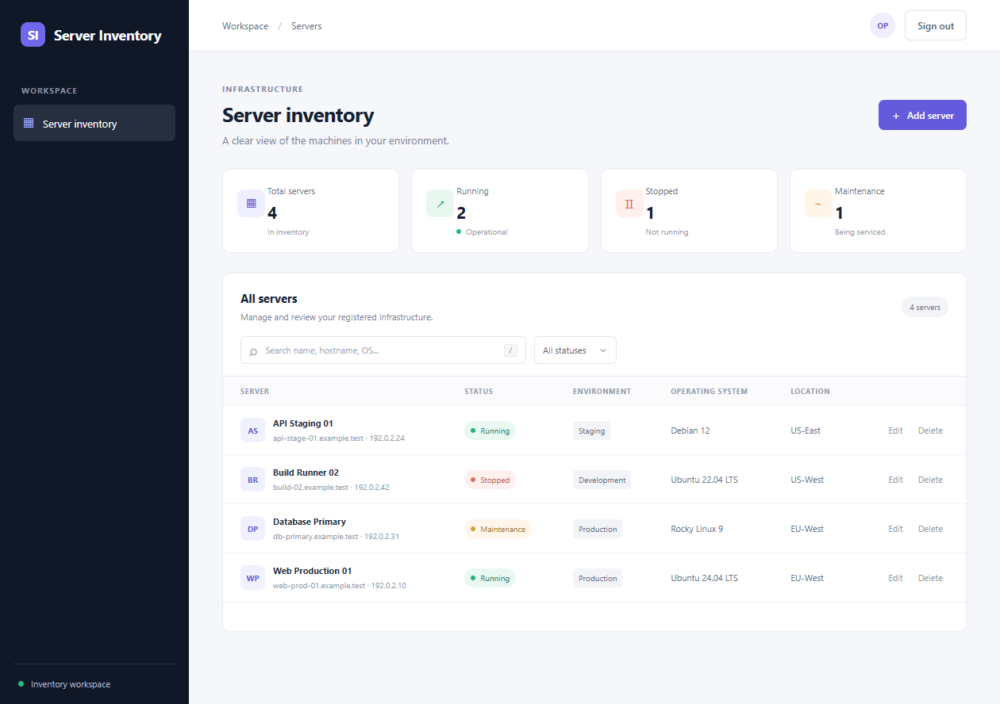
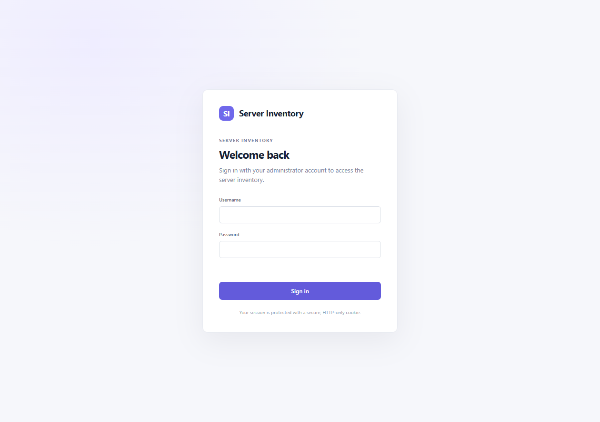

# Server Inventory

A lightweight web app for maintaining a server inventory. It provides a browser dashboard and a REST API, with SQLite for local development and PostgreSQL for Docker Compose deployments.

> **Scope:** This app records server details and user-entered status labels. It does not collect live metrics or logs, or start, stop, restart, or configure servers, since I do not have live servers to work with.

## Features

- Add, edit, search, filter, and remove server inventory entries.
- View server counts grouped by status.
- Sign in to the dashboard with an HTTP-only cookie session.
- Authenticate API clients using short-lived JWT bearer tokens.
- Protect cookie-authenticated writes with CSRF tokens and rate-limit sign-in attempts.
- Use SQLite locally or PostgreSQL with Docker Compose.
- Browse API documentation through OpenAPI and the interactive Scalar reference.
- Run unit and integration tests; GitHub Actions builds and tests changes.

## Screenshots

The dashboard screenshot uses synthetic server inventory data.

### Server inventory



### Sign in



## Quick start: local development

### Requirements

- [.NET 10 SDK](https://dotnet.microsoft.com/download/dotnet/10.0)
- A modern web browser

From PowerShell, open the project folder and configure credentials. The password is prompted without being displayed. The JWT signing key is generated randomly for this PowerShell session:

```powershell
$env:Authentication__Username = "admin"
$securePassword = Read-Host "Administrator password (at least 16 characters)" -AsSecureString
$env:Authentication__Password = [System.Net.NetworkCredential]::new("", $securePassword).Password
$jwtBytes = [byte[]]::new(48)
[System.Security.Cryptography.RandomNumberGenerator]::Fill($jwtBytes)
$env:Jwt__SigningKey = [Convert]::ToBase64String($jwtBytes)
dotnet run --launch-profile http
```

Open <http://localhost:5275> and sign in. Add inventory records from the dashboard. Keep the terminal open while the app is running; press **Ctrl+C** in it to stop the app.

Local development uses SQLite and creates `server-inventory.db` in the app's content directory. The environment variables above are temporary and must be set again in a new terminal session. Never commit real credentials or signing keys.

## Run with PostgreSQL and Docker Compose

### Requirements

- [Docker Desktop](https://www.docker.com/products/docker-desktop/) or Docker Engine with the Compose plugin

Copy the example environment file and replace every placeholder with unique secrets:

```powershell
Copy-Item .env.example .env
notepad .env
```

`ADMIN_PASSWORD` must be at least 16 characters. `JWT_SIGNING_KEY` must be at least 32 bytes. Start the app and database:

```powershell
docker compose up --build
```

Open <http://localhost:8080>. PostgreSQL data is stored in a named Docker volume. This development Compose setup publishes the app on localhost only and does not configure public HTTPS; production deployments should use a trusted HTTPS reverse proxy and a secret manager.

Stop the containers with **Ctrl+C** or `docker compose down`. This preserves the database volume. Avoid `docker compose down --volumes` unless you intend to delete the stored inventory.

## API documentation

When running in the Development environment:

| Resource | Local .NET run | Docker Compose |
| --- | --- | --- |
| OpenAPI JSON | <http://localhost:5275/openapi/v1.json> | <http://localhost:8080/openapi/v1.json> |
| Interactive Scalar API reference | <http://localhost:5275/scalar/v1> | <http://localhost:8080/scalar/v1> |

The API reference is Swagger-style interactive documentation powered by Scalar and ASP.NET Core OpenAPI. Protected operations still require authentication. Ready-to-use request examples are in [Server Inventory.http](./Server%20Inventory.http).

### Main endpoints

| Method | Endpoint | Description |
| --- | --- | --- |
| `POST` | `/api/auth/token` | Exchange the configured admin credentials for a JWT |
| `GET` | `/api/auth/me` | Get the signed-in user |
| `POST` | `/api/auth/logout` | End the browser cookie session |
| `GET` | `/api/servers` | List inventory entries |
| `GET` | `/api/servers?search=web&status=Running` | Search and filter entries |
| `GET` | `/api/servers/summary` | Get counts by status |
| `GET` | `/api/servers/{id}` | Get one entry |
| `POST` | `/api/servers` | Create an entry |
| `PUT` | `/api/servers/{id}` | Update an entry |
| `DELETE` | `/api/servers/{id}` | Delete an entry |

All `/api/servers` routes require authentication. For API clients, request a token:

```http
POST /api/auth/token
Content-Type: application/json

{
  "username": "admin",
  "password": "your-admin-password"
}
```

Then send the returned `accessToken` on API requests:

```http
Authorization: Bearer <accessToken>
```

JWTs expire after `Jwt:AccessTokenMinutes` (60 minutes by default). Browser requests use an HTTP-only cookie; state-changing cookie requests also require an `X-CSRF-TOKEN` header. The browser dashboard handles this automatically. Bearer-token API requests do not use cookie-based CSRF tokens.

## Configuration

Settings can be provided through environment variables. Double underscores (`__`) represent configuration sections:

| Variable | Required | Description |
| --- | --- | --- |
| `Authentication__Username` | Yes | Single administrator username |
| `Authentication__Password` | Yes | Administrator password; at least 16 characters |
| `Jwt__SigningKey` | Yes | JWT signing secret; at least 32 bytes |
| `Database__Provider` | No | `Sqlite` by default, or `PostgreSQL` |
| `ConnectionStrings__ServerInventory` | No | Database connection string |
| `Jwt__Issuer` | No | Token issuer; defaults to `ServerInventory` |
| `Jwt__Audience` | No | Token audience; defaults to `ServerInventory.Api` |
| `Jwt__AccessTokenMinutes` | No | Access-token lifetime; defaults to 60 minutes |

The app validates required credentials and JWT settings at startup. Environment variables for local development only apply to the terminal session that defines them. For deployments, provide secrets through the platform's secret manager.

SQLite is the default for local development. Docker Compose selects PostgreSQL automatically. To connect to an external PostgreSQL server, set `Database__Provider=PostgreSQL` and provide its connection string in `ConnectionStrings__ServerInventory`.

The database schema is currently initialized with EF Core `EnsureCreated`; migrations are not yet configured. SQLite data is not automatically transferred to PostgreSQL.

## Build and test

Build the app:

```powershell
dotnet build "Server Inventory.csproj" --configuration Release
```

Run unit and API integration tests:

```powershell
dotnet test "Server Inventory.Tests/Server Inventory.Tests.csproj" --configuration Release
```

GitHub Actions builds the application, runs tests, and builds the Docker image for pushes and pull requests. Workflow: [.github/workflows/ci.yml](./.github/workflows/ci.yml).

## Technology

- **Backend:** C#, .NET 10, ASP.NET Core Minimal APIs
- **Data:** Entity Framework Core, SQLite, PostgreSQL, Npgsql
- **Authentication:** Cookie authentication, JWT bearer tokens, CSRF protection
- **API docs:** ASP.NET Core OpenAPI, Scalar
- **Frontend:** HTML, CSS, JavaScript
- **Testing:** xUnit, ASP.NET Core integration testing
- **Infrastructure:** Docker, Docker Compose, GitHub Actions
- **Logging:** Structured JSON console logging

## Roadmap and limitations

This is an inventory foundation, not yet a remote server operations or monitoring system. It currently has one administrator account and no per-user roles or permissions. Status values are recorded in the inventory.